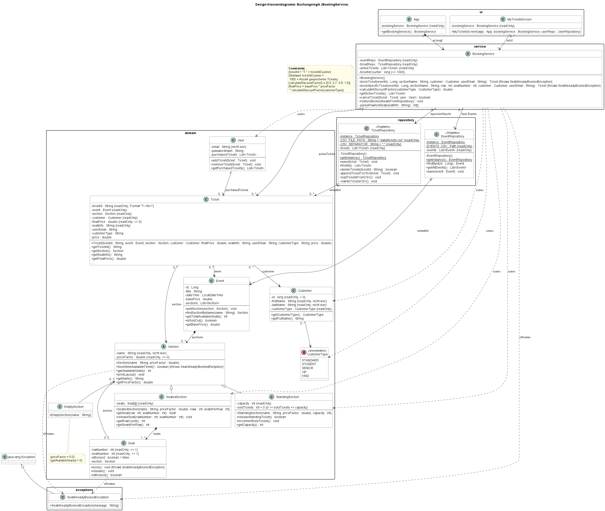
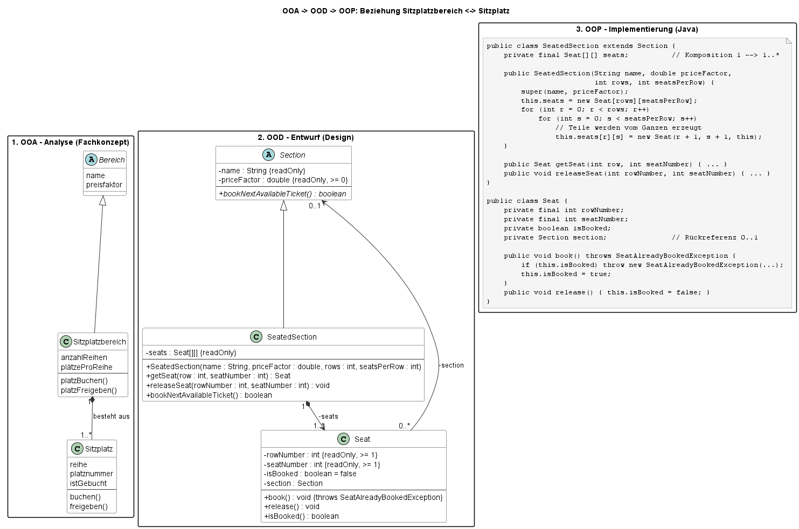

# Design-Klassendiagramme – Buchungslogik (`BookingService`)

Ausgewählter Teil des Projekts: die **Buchungslogik** des Eventarena Ticket-Verkauf-Systems.
Im Mittelpunkt steht die Klasse `service.BookingService`. Sie bucht Tickets (Stehplatz oder ein bestimmter Sitzplatz), berechnet Preise und Rabatte, storniert Tickets und stellt beim Start die belegten Plätze wieder her.

| Datei | Inhalt |
|---|---|
| [uml/01_Design_Klassendiagramm_BookingService.puml](uml/01_Design_Klassendiagramm_BookingService.puml) | Design-Klassendiagramm (OOD) des `BookingService` und aller beteiligten Klassen |
| [uml/02_OOA_OOD_OOP_SeatedSection_Seat.puml](uml/02_OOA_OOD_OOP_SeatedSection_Seat.puml) | Gegenüberstellung OOA → OOD → OOP am Beispiel der Beziehung *Sitzplatzbereich – Sitzplatz* |
| `uml/*.png` | gerenderte Bilder beider Diagramme |

> **Rendern:** in VS Code mit der Erweiterung *PlantUML* (jebbs.plantuml) → `Alt+D` für die Vorschau, Export als PNG/SVG über die Befehlspalette („PlantUML: Export Current Diagram“). Alternativ den Inhalt auf <https://www.plantuml.com/plantuml> einfügen.
> Wegen `!pragma layout smetana` ist **kein Graphviz** nötig.

---

## 1. Design-Klassendiagramm `BookingService`

### 1.1 Enthaltene Klassen (nach Paketen)

| Paket | Klassen | Rolle |
|---|---|---|
| `ui` | `App`, `MyTicketsScreen` | Clients: rufen Buchen bzw. Stornieren auf |
| `service` | `BookingService` | Steuerungsklasse (Control) mit der Buchungslogik |
| `repository` | `EventRepository`, `TicketRepository` | Persistenz (CSV), jeweils **Singleton** |
| `domain` | `Event`, `Section` (abstrakt), `SeatedSection`, `StandingSection`, `EmptySection`, `Seat`, `Ticket`, `Customer`, `CustomerType` (Enum), `User` | Fachklassen (Entity) |
| `exceptions` | `SeatAlreadyBookedException` | Fachliche Ausnahme (geprüfte Exception) |

### 1.2 Sichtbarkeit der Attribute

| Symbol | Bedeutung | Verwendung im Ausschnitt |
|:---:|---|---|
| `-` | private | **alle** Attribute, z. B. `- eventRepo : EventRepository`, `- ticketIdCounter : long`, `- seats : Seat[][]` |
| `+` | public | nicht verwendet; kein Attribut ist öffentlich (Datenkapselung) |
| `#` | protected | nicht verwendet; Unterklassen von `Section` greifen nur über `getName()`/`getPriceFactor()` auf die Attribute zu |
| `~` | package | nicht verwendet |
| unterstrichen (`{static}`) | Klassenattribut | `- instance`, `- CSV_FILE_PATH`, `- CSV_SEPARATOR`, `- EVENTS_CSV` |

**Constraints (Zusicherungen) an Attributen**, jeweils aus dem Code abgeleitet:

| Constraint | Klasse / Attribut | Umsetzung im Code |
|---|---|---|
| `{readOnly}` | alle `final`-Attribute, z. B. `BookingService.eventRepo`, `Ticket.ticketId`, `Seat.rowNumber` | Schlüsselwort `final` |
| `{nicht leer}` | `Section.name`, `Customer.firstName/lastName`, `User.email` | `IllegalArgumentException` im Konstruktor |
| `{>= 0}` | `Section.priceFactor` | Prüfung im Konstruktor von `Section` |
| `{> 0}` | `Customer.id` | Prüfung im Konstruktor von `Customer` |
| `{>= 1}` | `Seat.rowNumber`, `Seat.seatNumber` | Plätze werden mit `r + 1`, `s + 1` erzeugt |
| `{0 <= soldTickets <= capacity}` | `StandingSection.soldTickets` | `bookNextAvailableTicket()` / `releaseStandingTicket()` |
| `{>= 1000}` | `BookingService.ticketIdCounter` | Startwert `1000 + ticketRepo.findAll().size()` |
| `{Format "T-<Nr>"}` | `Ticket.ticketId` | `"T-" + ticketIdCounter` |
| `= false`, `= 0` | Anfangswerte `Seat.isBooked`, `StandingSection.soldTickets` | Konstruktor |

Constraints auf Klassenebene (als Notiz am `BookingService`):
- `{finalPrice = basePrice * priceFactor * calculateDiscountFactor(customerType)}`
- `{calculateDiscountFactor() ∈ {0.5, 0.7, 0.8, 1.0}}`: KIND 0.5, SENIOR 0.7, STUDENT 0.8, sonst 1.0

### 1.3 Sichtbarkeit der Operationen

| Klasse | public (`+`) | private (`-`) |
|---|---|---|
| `BookingService` | `bookTicket(..)`, `bookSpecificTicket(..)`, `calculateDiscountFactor(..)`, `getActiveTickets()`, `cancelTicket(..)`, `restoreBookedSeatsFromRepository()` | `parseRowAndSeat(seatInfo) : int[]` (interne Hilfsoperation, gehört nicht zur Schnittstelle) |
| `EventRepository` / `TicketRepository` | `{static} getInstance()`, `findById(..)`, `save(..)`, `findAll()`, `deleteTickets(..)` | **Konstruktor** (Singleton-Muster), CSV-Hilfsoperationen (`appendTicketToCSV`, `loadTicketsFromCSV`, `rewriteTicketsCSV`) |
| `Section` | `{abstract} bookNextAvailableTicket()`, `{abstract} getAvailableSeats()`, `{abstract} printLayout()` (kursiv, werden in den Unterklassen überschrieben) | – |

Ausnahmen werden als Eigenschaft der Operation notiert: `bookTicket(..) : Ticket {throws SeatAlreadyBookedException}`.

### 1.4 Beziehungen zwischen den Klassen

| Beziehung | UML-Notation | Multiplizität | Begründung im Code |
|---|---|---|---|
| `App` → `BookingService` | **Komposition** (gefüllte Raute, gerichtet) | 1 → 1 | `private final BookingService bookingService = new BookingService();`: `App` erzeugt das Objekt und hält es für seine gesamte Lebensdauer |
| `MyTicketsScreen` → `BookingService` | gerichtete **Assoziation** | 0..* → 1 | bekommt die Referenz im Konstruktor übergeben, erzeugt sie aber nicht |
| `BookingService` → `EventRepository`, `TicketRepository` | gerichtete **Assoziation** | 0..* → 1 | Attribute `eventRepo`, `ticketRepo`; es gibt genau eine Instanz (Singleton) |
| `BookingService` → `Ticket` | gerichtete **Assoziation** | 1 → 0..* | Liste `activeTickets` |
| `BookingService` ⇢ `Customer`, `User`, `CustomerType`, `SeatedSection`, `StandingSection` | **Abhängigkeit** `<<use>>` | – | nur als Parameter, lokale Variable oder Cast (`instanceof SeatedSection`), kein Attribut |
| `BookingService` ⇢ `SeatAlreadyBookedException` | **Abhängigkeit** `<<throws>>` | – | `throws`-Klausel |
| `EventRepository` → `Event`, `TicketRepository` → `Ticket` | **Aggregation** (leere Raute) | 1 → 0..* | Repository verwaltet die Objekte, die aber auch außerhalb weiterverwendet werden (z. B. Tickets im `User`) |
| `Event` → `Section` | **Komposition** | 1 → 0..* | Bereiche existieren nur innerhalb ihres Events; `getSections()` gibt nur eine Kopie heraus |
| `SeatedSection` → `Seat` | **Komposition** | 1 → 1..* | Sitze werden im Konstruktor erzeugt (`new Seat(..., this)`) |
| `Seat` → `Section` | gerichtete **Assoziation** (Rückreferenz) | 0..* → 0..1 | Attribut `section`; im 2-Parameter-Konstruktor nicht gesetzt, daher 0..1 |
| `Section` ◁— `SeatedSection`, `StandingSection`, `EmptySection` | **Generalisierung** | – | `extends Section`; `bookNextAvailableTicket()` ist polymorph |
| `Ticket` → `Event`, `Section`, `Customer` | gerichtete **Assoziation** | 0..* → 1 | `final`-Attribute im Ticket |
| `User` → `Ticket` | gerichtete **Assoziation** | 1 → 0..* | Liste `purchasedTickets` |
| `Exception` ◁— `SeatAlreadyBookedException` | **Generalisierung** | – | geprüfte Exception |

> Hinweis zur Darstellung: Referenzattribute (z. B. `- eventRepo`) stehen **sowohl** in der Klasse **als auch** als Assoziationslinie, damit der Bezug zum Java-Code direkt ablesbar ist. Streng genommen würde in UML eine der beiden Darstellungen reichen.

---

## 2. OOA → OOD → OOP am Beispiel einer Beziehung

**Beispiel:** *Ein Sitzplatzbereich besteht aus Sitzplätzen.* Genau diese Beziehung nutzt `BookingService.bookSpecificTicket()`
(`seatedSection.getSeat(row, seatNumber).book()`) und `cancelTicket()` (`seatedSection.releaseSeat(row, seat)`).

| | **OOA** (Analyse) | **OOD** (Entwurf) | **OOP** (Java) |
|---|---|---|---|
| **Klassen** | `Bereich`, `Sitzplatzbereich`, `Sitzplatz` (fachliche, deutsche Begriffe) | `Section` *(abstrakt)*, `SeatedSection`, `Seat` | `abstract class Section`, `class SeatedSection extends Section`, `class Seat` |
| **Attribute** | `reihe`, `platznummer`, `istGebucht` (ohne Typ, ohne Sichtbarkeit) | `- rowNumber : int {readOnly, >= 1}`, `- isBooked : boolean = false` | `private final int rowNumber;` `private boolean isBooked;` |
| **Operationen** | `buchen()`, `freigeben()` | `+ book() : void {throws SeatAlreadyBookedException}`, `+ release() : void` | `public void book() throws SeatAlreadyBookedException { ... }` |
| **Beziehung** | Komposition `Sitzplatzbereich 1 ◆—— 1..* Sitzplatz`, **ungerichtet** | Komposition **gerichtet** `SeatedSection 1 ◆——> 1..* Seat` (Rolle `-seats`) **plus** Rückreferenz `Seat 0..* ——> 0..1 Section` (Rolle `-section`) | `private final Seat[][] seats;` in `SeatedSection`, `private Section section;` in `Seat` |
| **Lebenszyklus** | „Ein Sitzplatz existiert nicht ohne seinen Bereich.“ | Komposition → das Ganze erzeugt die Teile | `new Seat(r + 1, s + 1, this)` im Konstruktor von `SeatedSection`; das Array ist `final` und wird nie nach außen ersetzt |
| **Fehlerfall** | „Ein gebuchter Platz kann nicht noch einmal gebucht werden.“ (Anforderung) | Constraint + Ausnahme in der Signatur | `if (isBooked) throw new SeatAlreadyBookedException(...)` |

**Was sich von Stufe zu Stufe ändert:**

1. **OOA → OOD**
   - Fachbegriffe werden zu Bezeichnern im Code (`Sitzplatz` → `Seat`).
   - Attribute bekommen **Datentypen, Sichtbarkeit und Constraints** (`- rowNumber : int {readOnly, >= 1}`).
   - Operationen bekommen **Parameter, Rückgabetyp und Ausnahmen**.
   - Die Beziehung bekommt eine **Navigierbarkeit** (Pfeil) und **Rollennamen**. Dabei wird entschieden, dass auch der Sitz seinen Bereich kennt (Rückreferenz `section`).
   - Die Multiplizität `1..*` wird in der Anordnung *Reihen × Plätze* umgesetzt, als zweidimensionales Feld `Seat[][]`.
2. **OOD → OOP**
   - Die Rolle `-seats` mit Multiplizität `1..*` wird zum Attribut `private final Seat[][] seats`.
   - `{readOnly}` wird zu `final`, die Komposition zur Objekterzeugung im Konstruktor des Ganzen.
   - `{throws ...}` wird zur `throws`-Klausel, der Constraint zur `if`-Prüfung.
